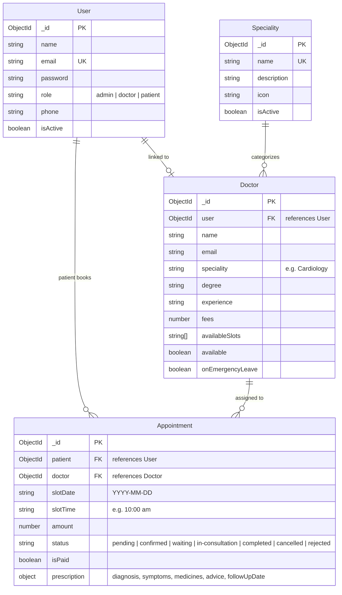

# Prescripto — Complete MERN Online OPD & Doctor Appointment System

Prescripto is an end-to-end hospital outpatient department (OPD) and doctor appointment management platform built with the MERN stack (MongoDB, Express, React, Node.js). It integrates three distinct user experiences into a unified, secure platform:

1. **Patient Portal** — Discover verified doctors, filter by medical department, view real-time available slots, book appointments safely, and track prescription history.
2. **Doctor Portal** — Manage daily clinical queues, transition patients from waiting to consultation, record diagnoses and medications, and generate digital prescription reports.
3. **Admin Portal** — Comprehensive operations dashboard to manage clinical specialities, register and audit doctors, monitor live patient waiting queues, view financial analytics, and manage scheduling conflicts.

---

## 1. System Architecture & Portals

The platform operates with a shared Express API backend, a central MongoDB database, and three Vite-powered React frontends. All three portals can be accessed through **Unified Development Routing on port `5173`** via Vite reverse proxying, or through their dedicated development ports.

| Portal / Service | Dedicated Port | Unified Proxy URL | Primary Responsibilities |
| :--- | :--- | :--- | :--- |
| **Shared Backend API** | `http://localhost:5000/api` | — | Express + Mongoose API, JWT auth, RBAC, concurrency-safe booking |
| **Patient Frontend** | `http://localhost:5173/` | `http://localhost:5173/` | Patient registration, doctor booking, prescription downloads |
| **Doctor Portal** | `http://localhost:5174/` | `http://localhost:5173/doctor` | Daily appointment queues, consultation & prescription builder |
| **Admin Portal** | `http://localhost:5175/` | `http://localhost:5173/admin` | Speciality CRUD, doctor/patient management, live queue, ledger |
| **Database** | `mongodb://127.0.0.1:27017/opd` | — | Persistent MongoDB storage with compound uniqueness constraints |

---

## 2. Folder Structure

```text
OPD System/
├── .gitignore                      # Top-level Git ignore rules (protects .env, node_modules, builds)
├── README.md                       # Complete technical & designer documentation
├── Doc/
│   ├── client/                     # Patient React frontend (Vite, Tailwind, Port 5173)
│   │   ├── src/
│   │   │   ├── assets/             # Logos, medical department illustrations, banner graphics
│   │   │   ├── components/         # Navbar, Footer, Banner, RelatedDoctors, SlotPicker
│   │   │   ├── context/            # AppContext (global state, user token, currency symbol)
│   │   │   ├── pages/
│   │   │   │   ├── user/           # Home, Doctors, Login, Register, Appointment, MyAppointments, MyProfile
│   │   │   │   └── Contact.jsx, About.jsx
│   │   │   ├── App.jsx             # React Router routing
│   │   │   └── main.jsx
│   │   ├── vite.config.js          # Reverse proxy configured for /admin and /doctor
│   │   └── package.json
│   └── server/                     # Original backup backend (kept for reference; do not run in production)
├── doctor-check/
│   ├── client/                     # Doctor React frontend (Vite, Tailwind, Port 5174)
│   │   ├── src/
│   │   │   ├── components/doctor/  # DoctorNavbar, DoctorSidebar, PrescriptionModal
│   │   │   ├── context/            # DoctorAuthContext
│   │   │   ├── pages/doctor/       # DoctorDashboard, DoctorAppointments, DoctorSchedule, DoctorProfile
│   │   │   ├── App.jsx             # Routes with /doctor base prefix
│   │   │   └── main.jsx
│   │   ├── vite.config.js          # Base set to /doctor/
│   │   └── package.json
│   └── server/                     # SHARED PRODUCTION BACKEND (Port 5000)
│       ├── config/                 # db.js (MongoDB connection with auto-reconnect)
│       ├── controllers/            # adminController, doctorController, appointmentController, authController, specialityController
│       ├── middleware/             # auth.js (JWT verify + role-based access control)
│       ├── models/                 # User.js, Doctor.js, Appointments.js, Speciality.js
│       ├── routes/                 # adminRoutes, doctorRoutes, appointmentRoutes, authRoutes, specialityRoutes
│       ├── scripts/                # createAdmin.js, resetAdminPassword.js
│       ├── test_complete_opd.js    # Automated 13-step end-to-end verification suite
│       ├── .env.example            # Environment variables template
│       ├── server.js               # Express entrypoint and route mounting
│       └── package.json
└── admin/                          # Hospital Admin React frontend (Vite, Tailwind, Port 5175)
    ├── src/
    │   ├── api/                    # adminApi.js (Axios instance with Bearer token interceptor)
    │   ├── components/             # AdminNavbar, AdminSidebar, AdminLayout, StatCard
    │   ├── context/                # AdminAuthContext (admin JWT session & role protection)
    │   ├── pages/                  # AdminDashboard, Specialities, Doctors, Patients, Appointments, LiveQueue, Analytics, AdminLogin
    │   ├── App.jsx                 # Routes with /admin base prefix
    │   └── main.jsx
    ├── vite.config.js              # Base set to /admin/
    └── package.json
```

---

## 3. Environment Variables Configuration

Create a `.env` file inside `doctor-check/server/` based on `doctor-check/server/.env.example`.

> **CRITICAL SECURITY NOTE:** Never commit actual `.env` files, API tokens, database connection credentials, or real patient personal identifiable information (PII) to version control.

```ini
# doctor-check/server/.env
PORT=5000
MONGO_URI=mongodb://127.0.0.1:27017/opd
JWT_SECRET=your_jwt_secret_key_change_in_production
NODE_ENV=development
CLIENT_URL=http://localhost:5173
ALLOWED_ORIGINS=http://localhost:5173,http://localhost:5174,http://localhost:5175
```

---

## 4. Setup & Running Locally

### Step 1: Start MongoDB
Ensure MongoDB is running locally on port 27017:
```powershell
# Windows Service or mongod command
mongod --dbpath "C:\data\db"
```

### Step 2: Install Dependencies (First Run Only)
```powershell
# Shared Backend
cd "doctor-check\server"
npm install

# Patient Frontend
cd "..\..\Doc\client"
npm install

# Doctor Frontend
cd "..\..\doctor-check\client"
npm install

# Admin Frontend
cd "..\..\admin"
npm install
```

### Step 3: Initialize or Reset the Administrator Account
To ensure the administrator account is ready without deleting any database records:
```powershell
cd "doctor-check\server"
node scripts/createAdmin.js --name "System Administrator" --email "admin@opd.local" --password "Admin@123456"
```
To safely change the administrator password at any time without creating duplicates:
```powershell
node scripts/resetAdminPassword.js --email "admin@opd.local" --new-password "YourNewPassword@123"
```

### Step 4: Run Services
Open four separate terminal windows or run them in background:

```powershell
# Terminal 1 — Shared Backend (Port 5000)
cd "doctor-check\server"
npm run dev

# Terminal 2 — Patient Frontend & Unified Reverse Proxy (Port 5173)
cd "Doc\client"
npm run dev

# Terminal 3 — Doctor Frontend (Port 5174)
cd "doctor-check\client"
npm run dev

# Terminal 4 — Admin Frontend (Port 5175)
cd "admin"
npm run dev
```

---

## 5. Unified Navigation & Default Credentials

| Portal | Preferred Unified URL | Direct Port URL | Default Login Email | Default Password |
| :--- | :--- | :--- | :--- | :--- |
| **Admin Portal** | `http://localhost:5173/admin` | `http://localhost:5175/` | `admin@opd.local` | `Admin@123456` |
| **Doctor Portal** | `http://localhost:5173/doctor` | `http://localhost:5174/` | `dr.smith@opd.local` / `dr.rohit@opd.local` | `doctor123` / `Doctor@123456` |
| **Patient Portal** | `http://localhost:5173/` | `http://localhost:5173/` | Self-registered patient | Configured during signup |

---

## 6. Main Features & Capabilities

### 1. Robust Role-Based Access Control (RBAC)
- All shared API routes are strictly guarded by JWT verification middleware.
- Only verified users with `role: 'admin'` can access `/api/admin/*` endpoints.
- Doctors and patients cannot access administrative capabilities.
- Ordinary users cannot be silently promoted.

### 2. Concurrency-Safe Appointment Booking
- Double-booking prevention is enforced at both the API controller layer and MongoDB database engine level.
- Compound unique partial index on `{ doctor: 1, date: 1, slot: 1 }` active for all appointments where status is not `cancelled`, `rejected`, or `doctor-unavailable`.
- If two patients attempt to book the exact same slot concurrently, only one booking succeeds; the other is rejected with a clean `HTTP 409 Conflict` message.
- Real-time booked slots querying (`GET /api/appointments/booked-slots/:doctorId?date=YYYY-MM-DD`) disables taken slots in the patient slot picker UI.

### 3. Dynamic Clinical Speciality Management
- Central `Speciality` collection with name, description, and status.
- Admin can add, edit, and deactivate departments.
- Patient search filters and Add Doctor forms fetch live specialities dynamically.

### 4. Doctor Queue & Lifecycle Management
- Status transitions: `pending` → `confirmed` → `waiting` → `in-consultation` → `completed`.
- Allows doctor to call waiting patients into consultation directly from the dashboard.
- Live administrative queue monitoring with 30-second polling.

### 5. Digital Prescriptions & Medical Record Privacy
- Structured consultation records: diagnosis, symptoms, clinical advice, medication list (name, dosage, frequency, duration, instructions), and recommended follow-up date.
- PDF generation / print dialog directly from the patient and doctor portals.
- Strict patient data isolation: patients can only view their own records; unauthorized requests return `HTTP 403 Forbidden`.

### 6. Emergency Leave & Scheduling Conflict Protection
- Doctors or admins can declare emergency leave.
- Affected appointments are placed on hold/cancelled with clear audit reasons, preserving complete appointment history without deleting records.

### 7. Financial Ledger & Revenue Analytics
- Clear distinction between total billable appointments vs. payments actually collected.
- Doctor-by-doctor revenue breakdown and monthly earnings trends.

---

## 7. Database Collections & Schema Relationships



---

## 8. Complete Page Inventory (Designer & UI Reference)

This inventory lists every screen in the system, its route, purpose, and key interactive UI controls to guide UI/UX redesigns and audits.

### A. Patient Portal (`Doc/client/`)
| Page | URL Route | Purpose | Key Interactive Controls |
| :--- | :--- | :--- | :--- |
| **Home** | `/` | Portal landing page, department showcase, featured top doctors | Department carousel buttons, "Book Appointment" hero CTA, Top Doctors grid |
| **Doctor Listing** | `/doctors`, `/doctors/:speciality` | Browse all active doctors or filter by clinical speciality | Dynamic speciality pills/sidebar, Doctor preview cards, "Book" button |
| **Doctor Profile & Booking** | `/appointment/:docId` | View doctor qualifications, consultation fee, biography, and book a visit | Date selector carousel, Concurrency-safe interactive time slot grid, "Book an appointment" button |
| **Patient Appointments** | `/my-appointments` | List patient's booked visits, check status, pay fee, view prescriptions | "Pay Online" button, "Cancel Appointment" button, "View Prescription" modal trigger |
| **Patient Profile** | `/my-profile` | View and edit personal demographic details | Edit/Save toggle button, phone, address, gender, and date of birth inputs |
| **Patient Login / Signup** | `/login`, `/register` | Secure patient email/password authentication | Login/Register tab switch, form submission buttons, password toggle |
| **About & Contact** | `/about`, `/contact` | Hospital OPD information, clinic addresses, contact forms | Inquire form inputs, emergency contact cards |

### B. Doctor Portal (`doctor-check/client/`)
| Page | URL Route | Purpose | Key Interactive Controls |
| :--- | :--- | :--- | :--- |
| **Doctor Dashboard** | `/doctor` | Daily summary, upcoming appointments, quick metrics | Stat cards (Earnings, Appointments, Patients), Quick appointment action buttons |
| **Doctor Appointments & Queue** | `/doctor/appointments` | Manage assigned appointments and live patient consultation queue | "Accept", "Reject", "Mark Waiting", "In Consult", and "Complete Consultation" buttons |
| **Prescription Builder** | Modal in `/doctor/appointments` | Record clinical consultation findings and prescribe medications | Diagnosis input, Symptoms text area, Add Medication row (name, dosage, frequency, duration), Follow-up date picker, "Save & Complete Consultation" button |
| **Doctor Schedule** | `/doctor/schedule` | Configure working days, start/end times, and slots | Working days toggles, slot generation controls, slot break exceptions |
| **Doctor Profile** | `/doctor/profile` | Update profile information, fees, and bio | Fees input, degree, experience, address, "Update Profile" button |
| **Emergency Leave** | Modal in `/doctor/schedule` | Declare emergency unavailability | Date range selector, Reason input, "Declare Emergency Leave" button |

### C. Admin Portal (`admin/`)
| Page | URL Route | Purpose | Key Interactive Controls |
| :--- | :--- | :--- | :--- |
| **Admin Login** | `/admin/login` | Secure administrator authentication with strict role enforcement | Email input, password input, "Sign In as Administrator" button |
| **Admin Dashboard** | `/admin/` | High-level hospital overview, operational metrics, today's appointments | Metric cards (Total Doctors, Patients, Appointments, Revenue), Recent bookings table |
| **Specialities Management** | `/admin/specialities` | CRUD management of hospital departments | "Add Speciality" button, Edit button, Status toggle switch (Active/Inactive) |
| **Doctors Management** | `/admin/doctors` | Complete doctor directory, credentials generation, status control | "Add Doctor" modal (with account creation, fee, slots), "Edit" modal, "Active/Inactive" toggle, "View Appointments" drawer |
| **Patients Management** | `/admin/patients` | Complete patient directory, manual registration, medical records audit | "Register Patient" modal, "Active/Blocked" toggle, "Medical History" dialog |
| **Appointments Management** | `/admin/appointments` | Hospital-wide appointments filter and conflict management | Status filter tabs (All, Pending, Confirmed, Waiting, In Consult, Completed, Cancelled), Doctor filter dropdown, Date filter, "Reschedule" modal, "Cancel" modal, "View Prescription" printable report |
| **Live Queue Monitor** | `/admin/queue` | Real-time monitoring of OPD waiting rooms and active consultations | Auto-refresh toggle (every 30s), Manual "Refresh Now" button, Live waiting room list, In-consultation doctor tracker |
| **Financial Analytics & Ledger** | `/admin/analytics` | Revenue analysis, collected fees vs. pending fees, doctor payout breakdown | Revenue summary cards, Doctor earnings table, Emergency leave audit log |

---

## 9. Automated Testing & Verification

The project includes an automated end-to-end integration test suite located at `doctor-check/server/test_complete_opd.js`.

To run the full suite:
```powershell
cd "doctor-check\server"
node test_complete_opd.js
```

### Verified Acceptance Test Sequence:
1. **Admin Authentication**: Verified `admin@opd.local` with strict role check.
2. **Speciality Creation**: Verified dynamic department creation (`/api/admin/specialities`).
3. **Doctor Registration**: Created Dr. Rohit with linked User credentials, slots, and fees.
4. **Doctor Authentication**: Verified Dr. Rohit can log in and obtain JWT.
5. **Patient Registration & Login**: Registered patient Anita Sharma.
6. **Patient Slot Booking**: Booked date/slot and confirmed appointment persistence.
7. **Concurrency Safety**: Attempted duplicate booking of the exact same slot; verified clean `HTTP 409 Conflict` rejection.
8. **Real-time Booked Slots API**: Verified endpoint returns booked slots to prevent double clicks.
9. **Queue Transitions**: Simulated queue progression: `confirmed` → `waiting` → `in-consultation`.
10. **Prescription Recording**: Saved diagnosis, symptoms, medications, advice, and marked fee as paid.
11. **Prescription Isolation**: Verified patient can view own prescription; verified other patients receive `HTTP 403 Forbidden`.
12. **Financial Ledger Reconciliation**: Verified Dr. Rohit's revenue and collections in admin analytics.
13. **Unified Port 5173 Proxy**: Verified `http://localhost:5173/`, `http://localhost:5173/doctor`, and `http://localhost:5173/admin` all return `200 OK`.

---

## 10. Preparing for GitHub

Before committing or pushing this repository:
1. Verify that your root `.gitignore` excludes:
   - All `.env` files
   - All `node_modules` folders
   - Production `dist` and `build` folders
   - Local database exports or log files
2. Run `git status` to confirm no sensitive files are staged.
3. Commit and push:
```powershell
git status
git add .
git commit -m "feat: complete MERN OPD system with unified routing, admin portal, concurrency-safe booking, and digital prescriptions"
git push origin main
```
